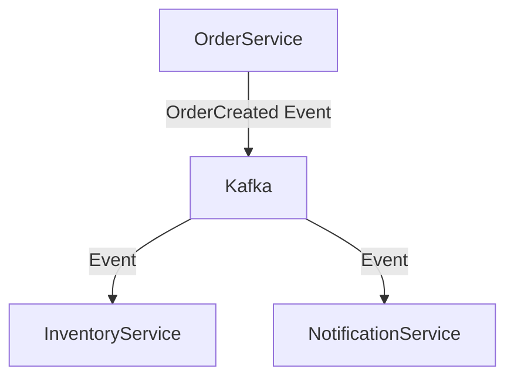
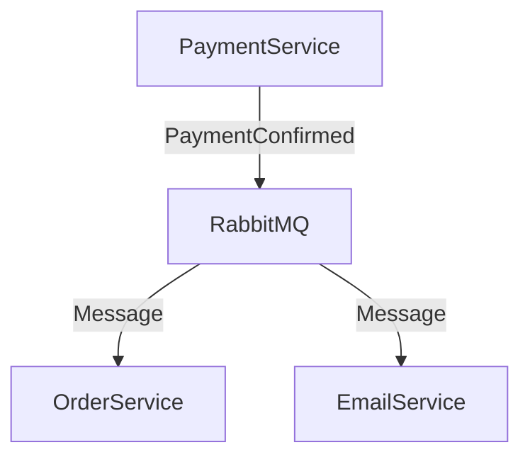

# Microservices Architecture: A Comprehensive Guide

Microservices architecture has revolutionized the way modern applications are built, deployed, and scaled. By decomposing large monolithic systems into smaller, loosely coupled, and independently deployable services, companies have gained agility, scalability, and resilience in their software systems. In this comprehensive blog post, we’ll deeply explore microservices, their benefits and challenges, popular communication patterns, and dive into how technologies like **Apache Kafka** and **RabbitMQ** facilitate communication between services.

---

## What Are Microservices?

**Microservices** is an architectural style wherein a single application is composed of many small, autonomous services, each responsible for a specific business capability. These services communicate with each other over lightweight protocols, typically HTTP APIs, message queues, or event streams.

### Characteristics of Microservices

- **Autonomous Deployability:** Each service can be deployed independently.
- **Decentralized Data Management:** Each microservice controls its own data, often with its own database.
- **Focused Scope:** Microservices are designed around business domains or capabilities.
- **Resilience:** Failure in one service does not directly impact others.
- **Polyglot Programming:** Services can be written in different languages or use different tech stacks.
- **Scalability:** Individual services can be scaled independently.

---

## Monolith Vs Microservices

| Aspect        | Monolithic Architecture          | Microservices Architecture      |
|---------------|---------------------------------|--------------------------------|
| **Deployment**| One large deployable unit        | Multiple independent services  |
| **Scalability**| Entire app scaled together      | Scale services independently   |
| **Development**| Harder to parallelize           | Easier team distribution       |
| **Resilience** | Failure can take down all       | Isolated to single service     |
| **Technology** | Single tech stack               | Polyglot, mixed tech stacks    |
| **Data Storage** | Typically one DB              | Decentralized per service      |

---

## Benefits of Microservices

1. **Flexibility in Technology Choices:** Teams can select the best tools for their service’s needs.
2. **Independent Development and Deployment:** Enables continuous delivery and faster releases.
3. **Scalability:** Services can be scaled horizontally based on their specific demand.
4. **Fault Isolation:** Failures are contained within a single service.
5. **Enhanced Maintainability:** Smaller codebases are easier to understand and maintain.

---

## Challenges in Microservices

Despite their advantages, microservices introduce new complexities:

- **Distributed Complexity:** Increased number of moving parts.
- **Network Latency and Failures:** Communication over the network is less reliable than in-process calls.
- **Data Consistency:** Maintaining consistency across distributed services is challenging.
- **Deployment & Testing:** Managing, deploying, and testing a suite of services is complex.
- **Monitoring & Logging:** Requires centralized and correlated logging and monitoring.

---

## Communication in Microservices

Communication is the backbone of a microservices architecture. Services must interact to deliver the overall system’s functionality. There are two main communication styles:

### 1. Synchronous Communication

- **REST APIs/HTTP:** Services call one another via HTTP, usually in a request/response pattern.
- **gRPC:** High-performance, language-agnostic RPC framework.

**Pros:** Simplicity, ease of implementation, clear request/response flow.  
**Cons:** Tightly coupled, potentially brittle (network outages propagate errors), not suited for all scenarios.

### 2. Asynchronous Communication

- **Message Brokers:** Services produce and consume messages via brokers (such as RabbitMQ and Kafka).
- **Event Streams:** Events are published to a stream and consumed by interested parties.

**Pros:** Loosely coupled, resilient, more scalable, supports event-driven architecture.

---

## Message Brokers: The Heart of Service Communication

To empower truly scalable and resilient architectures, organizations increasingly rely on message brokers for asynchronous communication.

### Why Use a Message Broker?

1. **Decoupling:** Services no longer need to know the location or implementation of other services.
2. **Resilience:** Message brokers buffer messages, allowing services to be temporarily offline.
3. **Scalability:** Enables load balancing and distributing work across multiple consumers.
4. **Event-Driven Capabilities:** Trigger actions as events happen throughout the system.

---

## Apache Kafka in Microservices

### What is Apache Kafka?

**Apache Kafka** is a distributed streaming platform designed for high-throughput, fault-tolerant, real-time data pipelines and event streaming. In a microservices context, Kafka is often used as an event streaming platform to connect microservices.

### Kafka Concepts

- **Producer:** Sends (publishes) messages to Kafka topics.
- **Consumer:** Reads messages from topics.
- **Topic:** Logical channel to group messages.
- **Partition:** Topics can be split for parallel processing and scalability.
- **Broker:** Kafka server that stores and serves messages.

### How Kafka Enables Communication

- **Event-Driven Architecture:** When a service changes state (e.g., a user signs up), it emits an event to Kafka. Other services subscribe to the relevant topics to react to these events.
- **Loose Coupling:** Services don’t call each other directly. As long as they agree on message formats and topics, they can evolve independently.
- **Durability and Scalability:** Kafka persists messages and supports high message volumes with low latency.

#### Example Scenario

1. **Order Service** emits an `OrderCreated` event to the `orders` topic.
2. **Inventory Service** subscribes to the `orders` topic and adjusts stock as necessary.
3. **Notification Service** subscribes to send user notifications when new orders are placed.

### Pros and Cons of Kafka

| Pros                   | Cons                              |
|------------------------|-----------------------------------|
| High throughput        | Steep learning curve              |
| Strong durability      | Overkill for simple scenarios     |
| Scalability            | Operations/administration overhead|

---

## RabbitMQ in Microservices

### What is RabbitMQ?

**RabbitMQ** is a widely-used open-source message broker that implements the Advanced Message Queuing Protocol (AMQP). It allows services to send and receive messages via queues with various routing patterns.

### RabbitMQ Concepts

- **Producer:** Application that sends messages.
- **Consumer:** Application that receives messages.
- **Queue:** Buffers messages until consumers retrieve them.
- **Exchange:** Routes messages to queues based on rules.
- **Bindings:** Links exchanges to queues with routing criteria.

### How RabbitMQ Enables Communication

RabbitMQ supports a variety of messaging patterns:

- **Work Queues:** Distribute time-consuming tasks among multiple workers.
- **Publish/Subscribe:** Broadcast messages to multiple consumers.
- **Routing and Topics:** Flexible routing logic using keys and patterns.

#### Example Scenario

1. **Payment Service** confirms a payment, sends a message to an `order_updates` queue.
2. **Order Service** listens to the queue and updates the order status.
3. **Email Service** listens to the same queue and sends confirmation emails.

### Pros and Cons of RabbitMQ

| Pros                   | Cons                                |
|------------------------|-------------------------------------|
| Simple to set up       | Lower throughput vs Kafka           |
| Advanced routing (AMQP)| Durability may need configuration   |
| Reliable delivery      | Not optimized for huge event logs   |

---

## Kafka vs RabbitMQ: Which to Choose?

| Feature            | Kafka                           | RabbitMQ                         |
|--------------------|---------------------------------|----------------------------------|
| Throughput         | High                            | Moderate                         |
| Message Retention  | Configurable (log-based)        | When consumed (queue-based)      |
| Latency            | Low                             | Low-to-medium                    |
| Routing            | Basic pub/sub                   | Advanced (topics, direct, fanout)|
| Durability         | Strong                          | Needs configuration              |
| Usage              | Event streaming, analytics      | Task queues, workflow automation |

- Choose **Kafka** for event streams, analytics, high throughput, or when historical event replay is valuable.
- Choose **RabbitMQ** for classic messaging, advanced routing, and simpler deployment requirements.

---

## Best Practices for Microservices Communication

1. **Prefer Asynchronous Communication:** Use brokers for loose coupling and resilience.
2. **Design for Failure:** Services (and brokers) should anticipate and handle failures gracefully.
3. **Idempotency:** Ensure repeated messages do not result in inconsistent state.
4. **Contract Testing:** Use toolkits like Pact to avoid breaking message contracts between services.
5. **Centralized Monitoring:** Instruments like Prometheus, Grafana, and ELK stack help in centralized logging and monitoring.

---

## Conclusion

Microservices architecture empowers organizations to build robust, independent, and fault-tolerant software systems. Effective communication is the keystone of such systems, and choosing the right pattern (synchronous vs asynchronous) and tool (Kafka, RabbitMQ, or others) is fundamental for success.

**Kafka** excels in event-driven, high-throughput, scalable scenarios where event logs and stream processing are needed. **RabbitMQ** shines in classic message queuing, flexible routing, and simplicity.

By leveraging these technologies and adhering to best practices, organizations can achieve the promised agility and scalability of microservices, while maintaining robustness and ability to evolve.

---

## Further Reading

- [Building Microservices, 2nd Edition - Sam Newman](https://www.oreilly.com/library/view/building-microservices-2nd/9781492034018/)
- [Microservices.io Patterns](https://microservices.io/patterns/)
- [Apache Kafka Documentation](https://kafka.apache.org/documentation/)
- [RabbitMQ Documentation](https://www.rabbitmq.com/documentation.html)

*Have more questions about microservices communication? Leave a comment below!*

